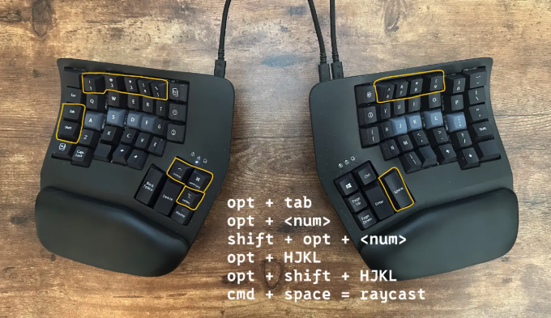

<div align="center">

# 🛠️ Dotfiles


_Velocity • Discoverability • Intelligence • Extensibility_


**My macOS development environment — crafted for speed and aesthetics.**

</div>

---

## 🏛️ Stack Overview

| Category | Tools |
| :------- | :---- |
| **Shell** | [Zsh](https://www.zsh.org/) + [Oh My Zsh](https://ohmyz.sh/) |
| **Terminal** | [Warp](https://www.warp.dev/) |
| **Editor** | [VSCode](https://code.visualstudio.com/) |
| **Prompt** | [Starship](https://starship.rs/) |
| **Node** | [NVM](https://github.com/nvm-sh/nvm) + Node LTS |
| **Git** | [Git](https://git-scm.com/) + [GitHub CLI](https://cli.github.com/) |
| **Note System** | [Obsidian](https://obsidian.md/) |

---

## 🚀 Installation

```bash
git clone https://github.com/frankfulness/dotfiles.git ~/.config/dotfiles
cd ~/.config/dotfiles
./install.sh --dry-run
./install.sh
```

**Shell + desktop setup** (also works after installing the apps separately):

```bash
./install.sh --desktop-only
exec zsh -l
```

Copies `.zshrc` to your home directory, restores the base configs, and installs/configures AeroSpace, SketchyBar, and JankyBorders. Existing configs are backed up first. Approve AeroSpace's Accessibility prompt when asked.

<details>
<summary>📦 What the script does</summary>

1. Copy shell configs and create Desktop PARA immediately, backing up prior files.
2. Install Homebrew, shell tools, Oh My Zsh, NVM, and Node LTS.
3. Restore Warp customization before installing the other apps.
4. Restore Git/VSCode settings and extensions, plus desktop tools if requested.

</details>

<details>
<summary>✅ Manual Steps After Install</summary>

1. Restart your terminal and sign in to your apps.
2. Open Docker Desktop to finish its setup.
3. Restore purchased Dato, Cursor Pro, and Keystroke Pro with `./install.sh --app-store`.
4. Install [Shure MOTIV Mix](https://www.shure.com/en-US/products/software/motiv-mix).
5. Activate licenses and approve macOS permissions as needed.

</details>

For installer options, private overrides, Git signing, and backups, see [ADDITIONAL.MD](ADDITIONAL.MD).

---

## 🖥️ Third-Party Apps

### 🔧 Productivity & Utilities

[](https://apps.apple.com/app/id1447043133)
[](https://clipy-app.com/)
[](https://sindresorhus.com/dato)
[](https://apps.apple.com/app/keystroke-pro/id1572206224)
[](https://www.raycast.com/)

### 💻 Development

[](https://www.usebruno.com/)
[](https://www.docker.com/)
[](https://code.visualstudio.com/)
[](https://www.warp.dev/)

### 🎨 Design & Creative

[](https://screen.studio/)
[](https://www.shure.com/en-US/products/software/motiv-mix)
[](https://www.affinity.studio/)
[](https://www.figma.com/)

### 📝 Writing & Notes

[](https://obsidian.md/)

### 🌎 Browsers

[](https://www.google.com/chrome/)

### 💬 AI & Communication

[](https://claude.ai/)
[](https://slack.com/)
[](https://zoom.us/)


---

## 🤓 CLI Tools

[](https://github.com/eza-community/eza)
[](https://git-lfs.com/)
[](https://gnupg.org/)
[](https://www.python.org/)
[](https://github.com/sharkdp/bat)
[](https://github.com/sharkdp/fd)
[](https://github.com/junegunn/fzf)
[](https://cli.github.com/)
[](https://git-scm.com/)
[](https://github.com/nvm-sh/nvm)
[](https://github.com/BurntSushi/ripgrep)
[](https://starship.rs/)
[](https://linux.die.net/man/1/tree)
[](https://github.com/ajeetdsouza/zoxide)
[](https://www.zsh.org/)

---

## ⌨️ Hardware & Other

[](https://kinesis-ergo.com/keyboards/advantage360/)
[](https://bambulab.com/)
[](https://www.raspberrypi.com/software/)
[](https://www.shure.com/en-US/microphones/mv7)
[](https://www.spotify.com/)

---

<div align="center">



_Built with ☕_

</div>
